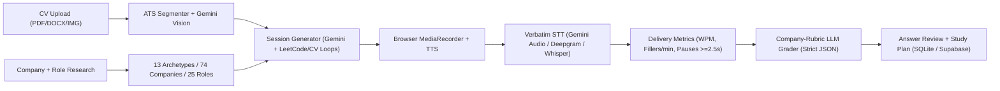

# rehearse.

**AI Voice Mock Interview Coach tailored to real company interview loops, CV deep dives, vocal delivery telemetry, and company-specific grading rubrics.**

Live GitHub Pages Demo: **[https://ilikeapplesandbananas.github.io/rehearse/](https://ilikeapplesandbananas.github.io/rehearse/)**

---

## What rehearse. Does

Unlike generic question banks, **rehearse.** connects four synchronized stages so every mock session reflects how specific engineering, data, cybersecurity, product, and consulting teams actually hire and score candidates:

1. **Universal CV Parser & Opportunity Auto-Detection**
   - Extracts candidate experience, education, skills, academic distinctions, certifications, and shipped projects from **PDF, DOCX, TXT, or image CVs** using structural ATS section segmentation paired with **Gemini Computer Vision** (`pypdfium2` page rendering + `gemini-3.1-flash-lite`).
   - Automatically detects any target company, role, and seniority track (`vac_work`, `intern_grad`, `junior`, `mid_senior`) mentioned in the CV summary/objective, or infers the strongest-fit target role from skills and projects when no company is specified.

2. **Company & Role Interview Intelligence (South African & Global Tech)**
   - Maps **13 interview archetypes**, **74 company overrides**, and **25 tech roles** (including **Vacation Work / Vac Work**, **Graduate Programmes**, **Software Engineering**, **Data & BI**, **AI / LLM Engineering**, **Cybersecurity / SOC / Penetration Testing**, **Industrial Automation & Intralogistics**, **Technical Project Management**, **Product Management**, **Business Analysis**, and **QA / SDET**).
   - Includes researched loops, coding/LeetCode patterns, and grading rubrics for **Gendac, iStore (Core Group), Electrum, KION Group / Dematic, Orange Cyberdefense (SensePost), Performanta, Mobius Consulting, ShopriteX, Derivco, Allan Gray, BBD, Entelect, Boxfusion, KRS, Deloitte InfinityX, Visa (VCA & Product), Vodacom, MTN, Takealot, Discovery, Capitec, Standard Bank, Investec, Luno, Yoco, Cape Union Mart, Bluespec Holdings, Railway Safety Regulator (RSR)** alongside **Stripe, Amazon / AWS, Google, Meta, Microsoft, Apple, OpenAI, Anthropic, CrowdStrike, Palo Alto Networks, Databricks, Snowflake**, and more.
   - Dynamically generates **researched Job Descriptions**, **seniority-calibrated interview rounds** (adjusting Vacation Work and Graduate interviews separately from experienced loops), and **What we'll explore** pillars whenever Company or Target Role changes.

3. **Tailored Question & Real Coding / LeetCode Generation**
   - Generates 5 to 8 probing interview questions grounded in the candidate's actual CV projects, real company-tagged **LeetCode / algorithm walkthroughs** (e.g., Hash Maps, Two Pointers, Sliding Window, BFS 2D Grid Routing, LRU Cache, Interval Merging), and behavioral / case loops.

4. **Voice Capture, Verbatim Transcription & Delivery Telemetry**
   - Records spoken responses in the browser via **MediaRecorder API** and transcribes verbatim audio with word timestamps via **Gemini Audio (`gemini-3.5-transcribe`)**, **Deepgram Nova**, **OpenAI Whisper**, **Groq Whisper**, or **Web Speech API**.
   - Computes objective vocal signals in Python (`services/delivery_metrics.py`):
     - **Speaking Rate (WPM)** (detects rushed delivery `>175 WPM` or slow recall `<100 WPM`)
     - **Filler Word Density / min** (`um`, `uh`, contextual `like`, `basically`, `you know`)
     - **Awkward Pauses (`>= 2.5s`)** from word-level timestamps
     - **Hedging Phrase Detection** (`I think maybe`, `I'm not really sure`, `I guess`, `if that makes sense`)

5. **Company-Specific & Role-Specific Answer Grading + Study Plan**
   - Grades answers strictly using **that target company's real evaluation rubric and expected answer structure** (e.g. Electrum thinking-out-loud discipline, Amazon `I` + STAR metrics, Stripe idempotency & financial precision, Orange Cyberdefense manual recon & remediation methodology, KION/Dematic 2D grid routing & hardware safety, Visa/Deloitte MECE/CIRCLES structuring).
   - Outputs calibrated sub-scores (`Communication`, `Technical Depth`, `Structure`, `Confidence`, `Overall`), two concrete diagnostic gaps, a tailored rewrite formula, a strong sample rewrite grounded in the candidate's CV, and targeted study resources saved to the persistent **Study Plan**.

---

## System Architecture



---

## Tech Stack

| Layer | Technology |
| --- | --- |
| **Frontend** | Next.js 16 (App Router, Turbopack), React 19, TypeScript, Tailwind CSS v4 |
| **Backend** | Python 3, FastAPI, Pydantic v2, Uvicorn, PyMuPDF/pypdf/pdfplumber, `pypdfium2`, Pillow |
| **LLM & Vision** | Google Gemini (`gemini-3.1-flash-lite` cascade), optional Anthropic Claude & OpenAI GPT-4o |
| **Speech-to-Text (STT)** | Gemini Multimodal Audio (`gemini-3.5-transcribe`), Deepgram Nova, OpenAI/Groq Whisper, Web Speech API |
| **Text-to-Speech (TTS)** | Browser Web Speech Synthesis, optional ElevenLabs / OpenAI TTS |
| **Database** | SQLite (`backend/rehearse.db`) for zero-config local runs + PostgreSQL/Supabase migration in `supabase/001_initial_schema.sql` |

---

## Local Development Quickstart

### 1. Backend (FastAPI on port `8008`)

```bash
cd backend
python -m venv .venv
# Windows PowerShell:
.\.venv\Scripts\Activate.ps1
# macOS/Linux:
# source .venv/bin/activate

pip install -r requirements.txt
cp .env.example .env
# Add your GEMINI_API_KEY (and optional DEEPGRAM_API_KEY / TAVILY_API_KEY) inside backend/.env

uvicorn main:app --host 127.0.0.1 --port 8008 --reload
```

Verify the backend health endpoint and automated pipeline tests:

```bash
cd backend
.\.venv\Scripts\python.exe test_pipeline.py
```

### 2. Frontend (Next.js on port `3000`)

```bash
cd frontend
npm install
cp .env.example .env.local
npm run dev
```

Open **`http://localhost:3000`** in your browser.

---

## GitHub Pages Mode

When deployed as a static site on GitHub Pages (`https://ilikeapplesandbananas.github.io/rehearse/`), the frontend includes an embedded client-side engine (`frontend/src/lib/static-fallback.ts`) backed by `frontend/src/data/company_intelligence.json` and `localStorage` persistence. You can also enter a personal `GEMINI_API_KEY` inside **Help & resources** in the browser to enable live Gemini question generation, grading, and PDF/image parsing directly from the static site.
